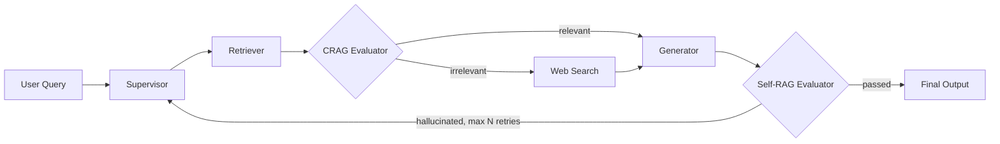

# Learning is for all

A study assistant that answers questions from **your own books and notes**, checks its
own answers, and falls back to the web when your material doesn't cover the question.
It reads scanned and handwritten pages (English and Arabic) with OCR, explains at the
level you choose, and generates practice quizzes.

Built on a CRAG + Self-RAG pipeline in LangGraph, with a Streamlit interface.


## Features

- **Tutor Chat**: ask a question and get an answer with numbered citations. Each reply
  is badged *From your notes* or *Includes web search*, and shows how it was built.
- **Three explanation levels**: Beginner, Intermediate, Expert.
- **Self-checking answers**: a grader keeps only relevant chunks (CRAG) and a second
  check verifies every claim is supported (Self-RAG). Unsupported answers loop back to
  be rewritten; if retries run out the answer is flagged `[LOW CONFIDENCE]`.
- **Web search fallback**: when your notes don't cover a question, it searches the web
  (Tavily or Serper). It can be switched off in the sidebar.
- **Quiz Studio**: practice questions on any topic, with answers you can reveal.
- **OCR for scans and handwriting**: scanned PDFs and photos are read with Gemini vision,
  with a local Ollama vision model as fallback. Results are cached per page, so nothing
  is OCR'd twice.
- **Library and OCR Inspector**: see what is indexed and compare each OCR'd page image
  with the text that was extracted.
- **Multilingual**: English and Arabic, using the `BAAI/bge-m3` embedding model.

## How it works



| Node | Code | What it does |
|---|---|---|
| User Query | `nodes.user_query` | normalises input, resets per-run state |
| Supervisor | `nodes.supervisor` | rewrites the question into a search query; on a retry it uses the critique to write a better one |
| Retriever | `nodes.retriever`, `vectorstore.py` | top-k chunks from ChromaDB |
| CRAG Evaluator | `nodes.crag_evaluator` | grades each chunk; "relevant" if at least `MIN_RELEVANT_DOCS` pass |
| Web Search | `nodes.web_search`, `websearch.py` | Tavily or Serper when nothing relevant was found |
| Generator | `nodes.generator` | answers only from the evidence with `[n]` citations; abstains if there is none |
| Self-RAG Evaluator | `nodes.selfrag_evaluator` | checks every claim is supported; unparsable grader output counts as a failure |
| Final Output | `nodes.output` | answer plus numbered sources |

The graph wiring and retry cap are in `graph.py`; shared state is in `state.py`.

## Requirements

- **Python 3.12** (recommended; the pinned `chromadb==0.5.23` is tested there)
- [Ollama](https://ollama.com) for the local fallback models
- A free [Gemini API key](https://aistudio.google.com/) for the main LLM and OCR
- Optional: a [Tavily](https://tavily.com) or [Serper](https://serper.dev) key for web search
- Optional but recommended: an NVIDIA GPU with the CUDA build of PyTorch, which makes
  indexing much faster (embeddings run on CPU otherwise)

## Setup

```bash
# 1. Create and activate a virtual environment (Python 3.12)
python -m venv venv312
venv312\Scripts\activate           # Windows
# source venv312/bin/activate      # macOS / Linux

# 2. Install
python -m pip install -r requirements.txt

# 3. Local models (used offline and when the Gemini free quota runs out)
ollama pull llama3.2
ollama pull qwen2.5vl:3b

# 4. Configure
copy .env.example .env             # Windows   (cp .env.example .env on macOS / Linux)
# then edit .env and add your keys

# 5. Add your material to data/docs/, then index it
python -m rag_graph ingest

# 6. Run the app
python -m streamlit run app.py
```

Supported files: `.pdf`, `.docx`, `.md`, `.txt`, `.jpg`, `.jpeg`, `.png`.

**Subjects:** put files in sub-folders to group them, for example
`data/docs/Circuits/lecture1.pdf` has the subject `Circuits`. You can limit a question to
one or more subjects in the sidebar. A file at the top level uses its own name as the subject.

## Command line

```bash
python -m rag_graph ingest                 # index new or changed files only
python -m rag_graph ocr                    # OCR scanned pages only (fills the cache, no embedding)
python -m rag_graph ask "What is a Karnaugh map?" -v
python -m rag_graph chat -v                # interactive; type /level expert to change level
python -m rag_graph quiz "Logic gates"     # practice questions
python -m rag_graph mermaid                # print the graph as a Mermaid diagram
pytest                                     # routing tests, no models or network needed
```

`-v` prints the node-by-node path of each answer.

## Configuration

Settings live in `rag_graph/config.py` and are overridden by environment variables or `.env`.

| Variable | Default | Meaning |
|---|---|---|
| `GEMINI_API_KEY` | none | key for the main LLM and OCR |
| `LLM_PROVIDER` | `gemini` | `gemini` (falls back to Ollama) or `ollama` |
| `LLM_MODEL` | `gemini-2.5-flash` | Gemini chat model |
| `LOCAL_LLM_MODEL` | `llama3.2` | Ollama model used as the fallback |
| `OLLAMA_BASE_URL` | `http://localhost:11434` | where Ollama runs |
| `EMBEDDING_MODEL` | `BAAI/bge-m3` | multilingual embedding model |
| `WEB_PROVIDER` | `tavily` | `tavily`, `serper` or `none` |
| `TAVILY_API_KEY` / `SERPER_API_KEY` | none | key for the chosen search provider |
| `WEB_MAX_RESULTS` | `3` | web results per search |
| `OCR_PROVIDER` | `gemini` | `gemini` (falls back to Ollama), `ollama` or `none` |
| `OCR_MODEL` | `gemini-2.5-flash` | Gemini model used for OCR |
| `LOCAL_OCR_MODEL` | `qwen2.5vl:3b` | Ollama vision model for OCR |
| `OCR_LOCAL_FALLBACK` | `true` | when the daily Gemini quota is used up, continue with the local model (`false` = stop and resume the next day) |
| `OCR_MIN_CHARS` | `50` | a PDF page with less text than this may be sent to OCR |
| `OCR_MIN_INTERVAL` | `6.5` | seconds between Gemini OCR calls (free-tier rate limit) |
| `CHUNK_SIZE` / `CHUNK_OVERLAP` | `1800` / `250` | indexing chunk size and overlap |
| `TOP_K` | `6` | chunks retrieved per question |
| `MIN_RELEVANT_DOCS` | `1` | relevant chunks needed to skip the web fallback |
| `MAX_RETRIES` | `2` | Self-RAG loop-backs before giving up |
| `EXPLAIN_LEVEL` | `beginner` | default explanation level |

Never commit your `.env` file. It is listed in `.gitignore`; `.env.example` holds placeholders only.

## Project layout

```
app.py                Streamlit app (Tutor Chat, Quiz Studio, Library & OCR Inspector)
rag_graph/
  main.py             command-line interface and dependency wiring
  graph.py            LangGraph state machine and routing
  nodes.py            the agents (supervisor, retriever, evaluators, generator, output)
  state.py            graph state
  llm.py              Gemini with Ollama fallback
  vectorstore.py      file loading, chunking, ChromaDB indexing, retrieval
  ocr.py              cached OCR (Gemini, Ollama fallback)
  websearch.py        Tavily / Serper
  study.py            quiz generation
  config.py           settings
tests/                routing tests
data/docs/            your books and notes (not committed)
data/ocr_cache/       cached OCR text (not committed)
chroma_db/            the vector index (not committed)
```

## Tips and troubleshooting

- **`KeyError: '_type'` or "Could not load the indexed library".** The index was created
  by a different `chromadb` version. Use one virtual environment, move the old
  `chroma_db` folder aside and run `python -m rag_graph ingest` again.
- **Indexing looks stuck.** On CPU the embedding model is slow on large books. Install the
  CUDA build of PyTorch, and watch the `embedded N/M chunks` progress lines.
- **Gemini free quota used up.** Ingest stops or switches to the local model. For better
  OCR of handwriting, set `OCR_LOCAL_FALLBACK=false`, then run `python -m rag_graph ingest`
  again the next day; cached pages are never redone.
- **Weak or garbled OCR from the local model.** Output that is mostly symbols is rejected
  and retried on the next ingest. `python clean_ocr_cache.py` lists such pages
  (add `--delete` to remove them), and the OCR Inspector shows the engine used for each page.
- **Digital books are not OCR'd.** A PDF where most pages already have a text layer is
  treated as digital, so figure and divider pages are skipped. Only real scans use OCR.
- **No web results.** Check that `WEB_PROVIDER` and the matching API key are set, and that
  the sidebar toggle is on.

## Swapping parts

Everything external is injected through `Deps` in `nodes.py`. Replace `get_llm` in `llm.py`
to use another model, `vectorstore.py` for another vector database, or `websearch.py` for
another search API.

## License

Add a license of your choice here (for example MIT), and a note about any copyrighted
material you index.
